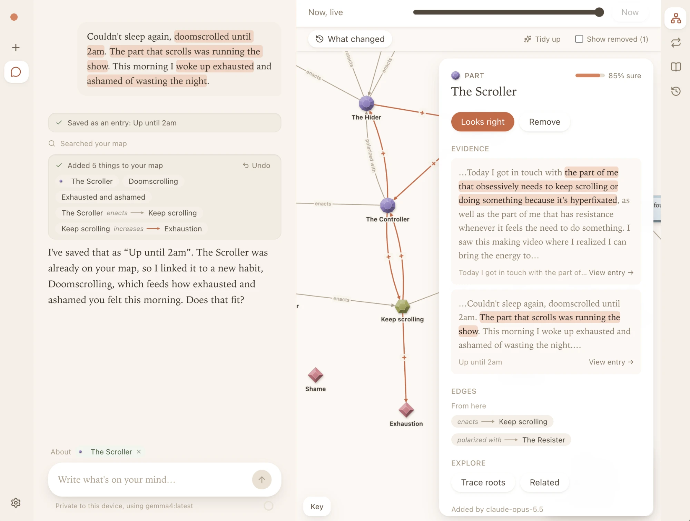
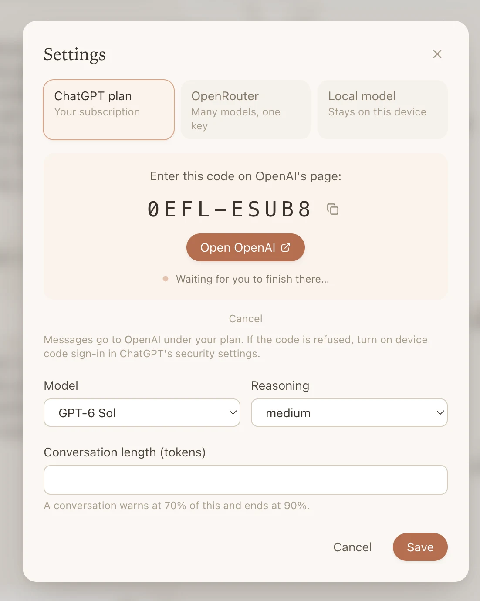
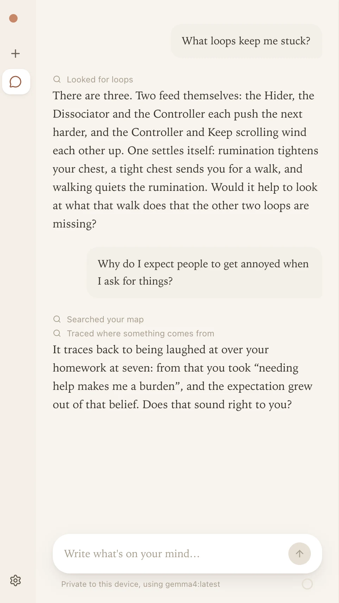
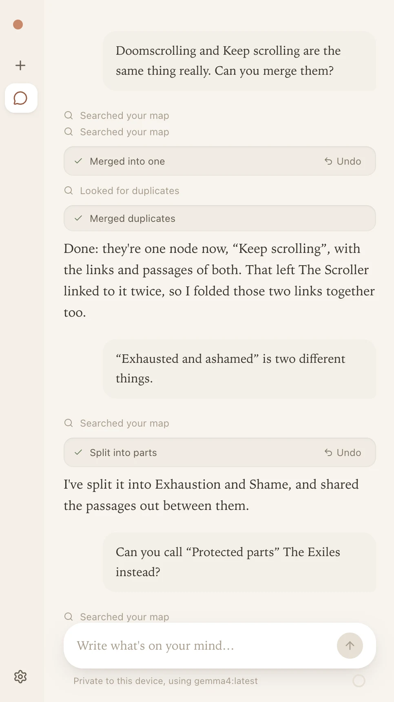
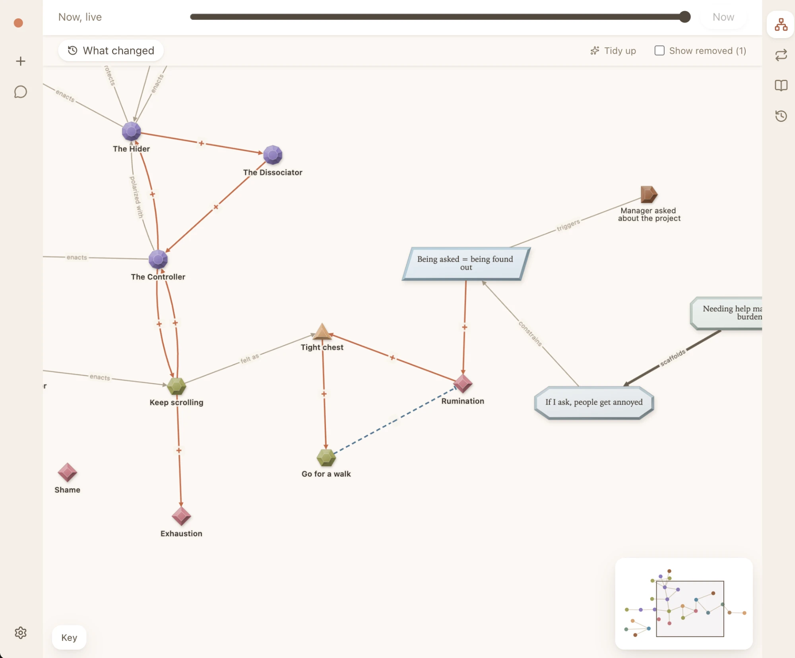
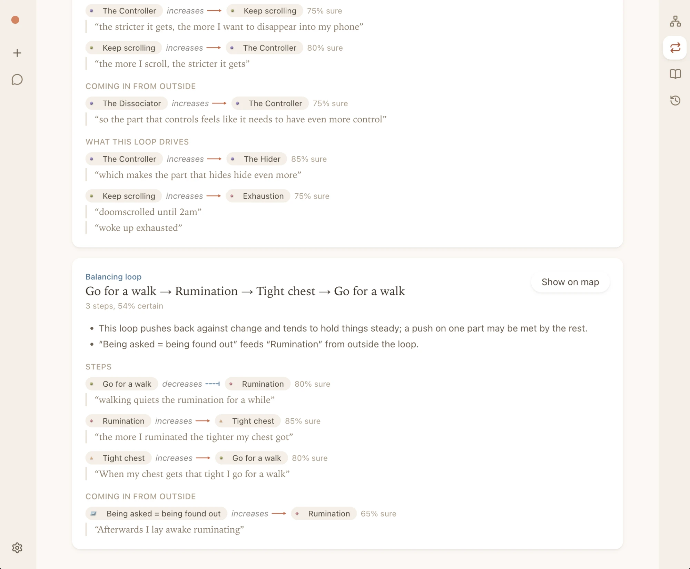
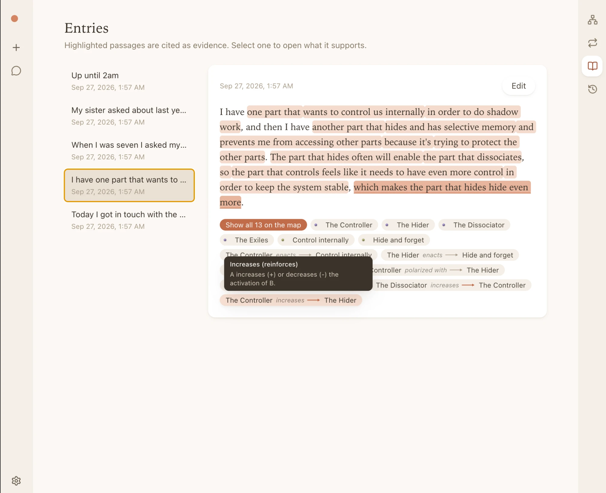

<h1 align="center">Inner Graph</h1>

<p align="center">
  <strong>A map of your inner life, automatically built from your writing.</strong>
</p>

<p align="center">
  <a href="https://github.com/innerlattice/innergraph/releases/latest"></a>
  <a href="https://github.com/innerlattice/innergraph/releases"></a>
  
  
  <a href="docs/MCP.md"></a>
</p>

<p align="center">
  
</p>

You write to an assistant about what is going on, the way you would in a journal. The assistant
picks out the parts of you, beliefs, memories, and feelings in what you wrote, and how they
feed one another, then adds them to a map you can look at, question, and correct. Everything on the map
points back to your own words, and every change can be undone.

It runs on your computer. Your writing and your map are kept in an encrypted file on your own
disk.

Version <!-- version -->0.4.7<!-- /version -->. What changed in each version is in the
[changelog](CHANGELOG.md).

## What it's like

- **Your words, not a diagnosis.** On the map, every part, belief, and link quotes your own
  words as evidence. Click any one to read what you actually wrote.
- **Suggestions you confirm.** What the assistant adds is a guess until you say it “Looks
  right”. Tell it what's wrong in plain words and it fixes the map.
- **Loops you can see.** It finds the patterns that keep themselves going, and the ones that
  settle themselves, and walks you through them step by step.
- **Nothing is lost.** Every change is kept. Undo one change, undo a whole set at once, or return
  the map to last week's version.
- **Private if you want it to be.** Use a model on your own computer and nothing you write
  leaves it. Searching your map always runs locally.
- **Works with the assistants you already use.** Claude, Codex, and Hermes Agent can read and
  add to the same map.

## Install

Download the installer for your computer from the
[latest release](https://github.com/innerlattice/innergraph/releases/latest):

| Computer | File |
| --- | --- |
| Mac with Apple silicon (M1 or later) | `Inner-Graph-…-mac-arm64.dmg` |
| Mac with an Intel chip | `Inner-Graph-…-mac-x64.dmg` |
| Windows | `Inner-Graph-…-win-x64.exe` |

The installers aren't signed yet, so your system warns you the first time you open the app:

- **macOS** says the app “can't be opened” or is “damaged”. Right-click the app in
  Applications and choose Open. If that doesn't work, run this in Terminal:

  ```bash
  xattr -dr com.apple.quarantine "/Applications/Inner Graph.app"
  ```

- **Windows** says it “protected your PC”. Choose More info, then Run anyway.

## Choose a model



The assistant needs a language model. Open Settings (bottom left) and pick one:

- **ChatGPT plan**: uses your ChatGPT subscription. Choose Connect ChatGPT and enter the code
  on OpenAI's page.
- **OpenRouter**: one key for many models. Paste your OpenRouter key.
- **Local model**: a model running on your own computer through
  [Ollama](https://ollama.com), LM Studio, or any OpenAI-compatible server. Nothing you write
  leaves your computer.

With ChatGPT or OpenRouter, what you write and the parts of your map the assistant reads are
sent to that provider. The app says so under the message box whenever a hosted model is in
use.

Searching your map always runs on your computer, with a small model that comes with the app
and understands meaning in many languages, so finding “my father” also finds “Dad”.

<br clear="right">

## Using it

### Write

Tell the assistant what happened or what you're thinking about. The assistant saves your
message as an entry, adds what it finds to the map, and shows each change as a card with an
Undo button. The passages the assistant used are highlighted in your message; click one to see
what that passage became on the map.

### Ask and correct

Ask about your map the way you'd ask a friend who has read your journal: what keeps you stuck,
where a belief comes from, what's related to this. When the assistant gets something wrong,
say so. The assistant can merge two things that are really one, split one that is really two,
rename, remove, and bring things back.

<p align="center">
  
  &nbsp;
  
</p>

What the assistant adds is a suggestion until you say it “Looks right”. You can also rename,
merge, remove, and restore things yourself.

### Look at the map

The views are in the rail on the right.

**Map**: every item and how the items connect. Each kind of thing has its own shape and
colour, and increases and decreases are drawn differently, so you can read the map at a glance. Click to
select one item; shift-click or drag a box to select several. What you select appears above the
message box, so you can ask the assistant about “these”. Drag the timeline at the top to see the
map at any earlier moment, and open What changed to see what's new.

<p align="center">
  
</p>

**Loops**: patterns that keep themselves going, step by step, each step with the words it
came from, and what feeds the loop from outside and what it drives.

<p align="center">
  
</p>

**Entries**: everything you've written, with what each entry supports on the map. Select a
highlighted passage to open what it supports.

<p align="center">
  
</p>

**Log**: every change, in order, with who made it.

### Explore

Choose Explore on any item to work on that item with the assistant: make sense of how the item
fits, answer a few questions to fill in the map around the item, ask “why” five times, or look
for where a loop could ease.

### Undo anything

Nothing is ever destroyed. Undo a single change from its card, undo a whole set of changes
from History, bring back something removed, or return the whole map to an earlier
time.

Conversations are in the rail on the left. A long conversation warns you as it fills up and
then ends; start a new one and carry on, since the map keeps everything.

## Use it from other assistants

Claude Desktop, Claude Code, Codex, and Hermes Agent can read and add to the same map. Open
Settings, find “Connect other agents”, pick your assistant, and put the snippet where the app
tells you to. The assistant then knows how to work with your map, and its changes are recorded under
its own name, so you can see and undo them like any others. The map in the app updates live
while the assistant works.

More detail, including read-only connections and the full list of tools, is in
[docs/MCP.md](docs/MCP.md).

## Your data

The app keeps everything in one folder, created the first time it runs:

- macOS: `~/Library/Application Support/Inner Graph/vault`
- Windows: `%APPDATA%\Inner Graph\vault`

The folder holds the encrypted database and `vault.key`, the key that opens the database. To back up or
move your map, copy the whole folder while the app is closed. Without `vault.key` the database
can't be read, so keep them together, and keep the folder private: anyone with both files can
read your map.

## A note on care

Inner Graph is a tool for reflecting on your own writing. It isn't therapy, and the assistant
won't present itself as a therapist. If you're in crisis or thinking about hurting yourself,
please reach out to someone now: in the US and Canada, call or text 988; elsewhere, find a
line at [findahelpline.com](https://findahelpline.com).

## Questions

**Does it need the internet?** Only to reach a hosted model. With a local model, the whole app
works offline.

**Which languages does it understand?** The search model understands many languages. How well the
assistant writes and reads yours depends on the model you choose.

**Can I edit what I wrote?** Yes. Open the entry and choose Edit. The passages the map cites carry
over, and the app tells you which items cite text that changed.

**How do I report a problem or suggest something?** Open an
[issue](https://github.com/innerlattice/innergraph/issues).

## More

- [CONTRIBUTING.md](CONTRIBUTING.md): running from source, the command line, tests, building
  installers, and shipping versions.
- [docs/ARCHITECTURE.md](docs/ARCHITECTURE.md): how it is built and why.
- [docs/SPEC.md](docs/SPEC.md): the core model and its vocabulary.
- [docs/DESIGN.md](docs/DESIGN.md): the visual design system.
